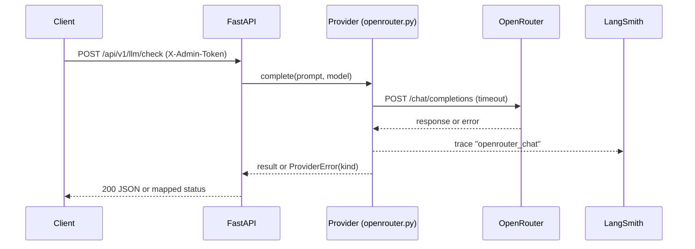
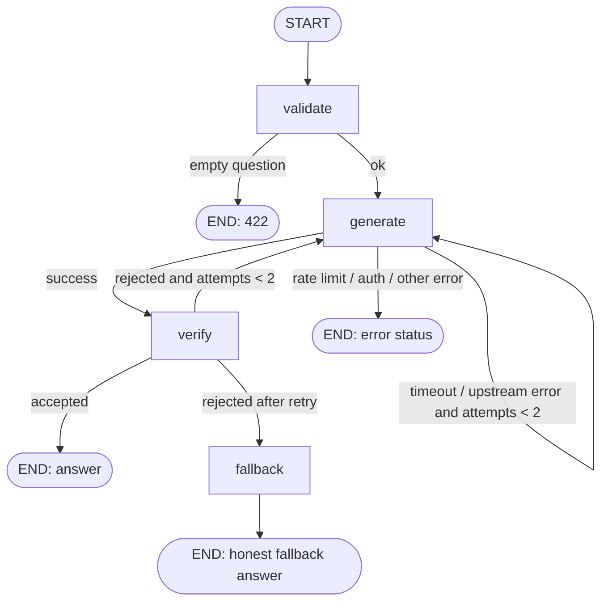

# Architecture

## Layers
| Layer | Folder | Responsibility |
|---|---|---|
| Routes | `api/v1/` | HTTP only: parse, auth, map errors to status codes |
| Schemas | `schemas/` | Pydantic request/response models |
| Services | `services/` | Business logic; runs the graph, logs metadata |
| Graph | `graph/` | LangGraph state, nodes, edges, builder |
| Providers | `providers/` | Talk to an LLM vendor; classify errors |
| Core | `core/` | Settings, logging, request ID context |

## Rules
- `/health` never depends on external services.
- Errors returned to clients are generic; logs hold metadata only (no question/answer text, no stack traces).
- Secrets only come from environment variables.
- Protected endpoints need `X-Admin-Token` until real auth + rate limiting exist.

## Phase 1: LLM connectivity check

## Phase 2: Chat workflow (LangGraph)

`POST /api/v1/chat` runs this graph. Each node appears as a step in LangSmith, under a root run named `agentops_chat` whose ID equals the `run_id` in the API response.

### Retry policy
| Situation | Action |
|---|---|
| Timeout, upstream 5xx | Retry once after 1s |
| Rate limited (429) | No retry; return 429 (retrying wastes free quota) |
| Auth, bad request, not configured | No retry; return 502/503 (our configuration problem) |
| Empty/too-short answer | Retry once, then fallback answer |
| Total generate calls | Max 2 per request |

### State
`AgentState` (graph/state.py): run_id, question, answer, model, attempts, verdict, fallback, error_kind, error_message, steps.

### Known limitation (by design)
`verify` is a placeholder (non-empty check). In Phase 3 it checks the answer against retrieved document chunks.

### Privacy note
LangSmith traces contain the prompt and answer text. Before handling real user documents, set `LANGSMITH_HIDE_INPUTS=true` and `LANGSMITH_HIDE_OUTPUTS=true` or disable tracing.
