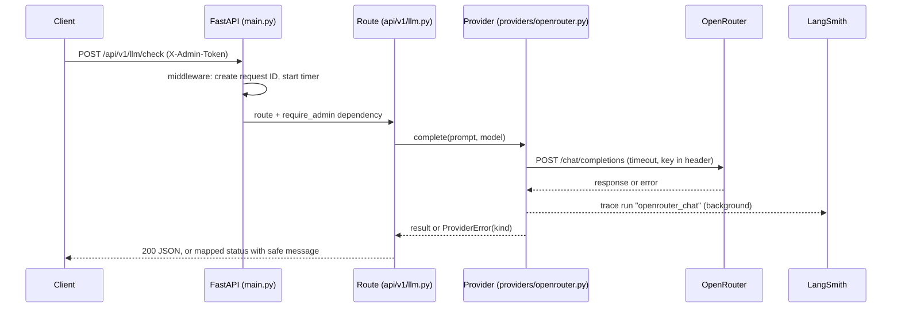

# Architecture (Phase 1)

## Request flow: LLM connectivity check

## Layers
| Layer | Folder | Responsibility |
|---|---|---|
| Routes | `api/v1/` | HTTP only: parse, auth, map errors to status codes |
| Schemas | `schemas/` | Pydantic response/request models |
| Providers | `providers/` | Talk to an LLM vendor; classify errors; no HTTP concepts leak out |
| Core | `core/` | Settings, logging, request ID context |

## Rules
- `/health` never depends on external services.
- Errors returned to clients are generic; details go to structured logs (exception type only).
- Secrets only come from environment variables.
