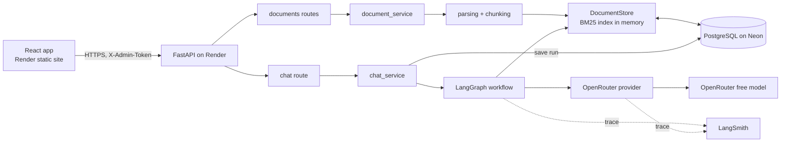
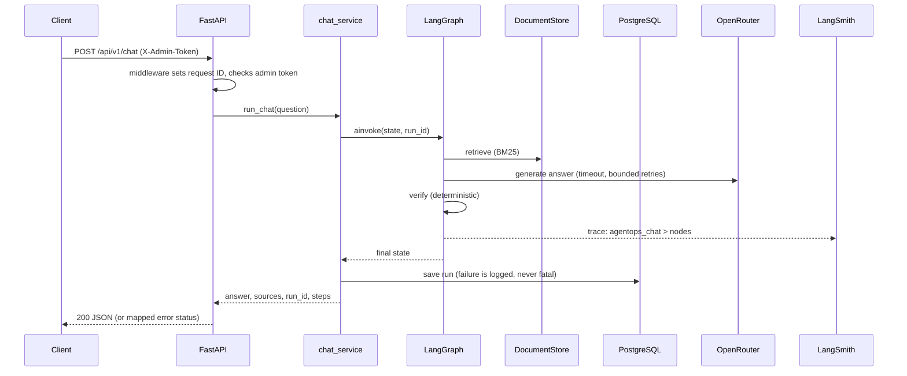

# Architecture

## Layers
| Layer | Folder | Responsibility |
|---|---|---|
| Frontend | `frontend/` | React UI: connect, documents, ask, history. Static files; calls the API from the browser |
| Routes | `api/v1/` | HTTP only: parse, auth, map errors to status codes |
| Schemas | `schemas/` | Pydantic request/response models |
| Services | `services/` | Business logic: ingest documents, run the chat graph, log metadata |
| Graph | `graph/` | LangGraph state, nodes, edges, builder |
| Retrieval | `retrieval/` | Parsing, chunking, BM25 index, document store (database-backed) |
| Database | `db/` | SQLAlchemy models, sessions, all SQL (`repo.py`); migrations in `alembic/` |
| Providers | `providers/` | One OpenAI-compatible client for OpenRouter, Groq, Gemini and Mistral; failover between them; error classification |
| Core | `core/` | Settings, logging, request ID context, auth (roles), demo tokens, demo limits, CORS |
| Demo | `demo/` | Bundled sample document and idempotent seeding |

## Rules
- `/health` never depends on external services.
- Errors returned to clients are generic. Logs hold metadata only: no questions, answers, document text, or stack traces. (The `runs` table does store question and answer text; see DATABASE.md.)
- Secrets only come from environment variables.
- Two roles: the owner (`X-Admin-Token`, full access) and demo visitors (`X-Demo-Token`, a signed short-lived token; read-only, sample document only, rate limited). See [DEMO_MODE.md](DEMO_MODE.md).
- Browsers may call the API only from origins listed in `CORS_ORIGINS` (exact addresses, `*` rejected, no cookies).
- Routes stay thin; the graph and services hold the logic.

## System overview

## One chat request, end to end

The workflow graph itself is drawn in [RAG_FLOW.md](RAG_FLOW.md).

## Request IDs, run IDs, trace IDs
- `X-Request-ID` header: one per HTTP request; appears in every log line.
- `run_id` in the chat response: also the LangSmith root run ID, so one ID links the API response, logs, and trace.

## Persistence in one paragraph
PostgreSQL (Neon) is the source of truth for documents, chunks and run history. Searching uses an in-memory BM25 index that is rebuilt from the database at startup, and writes go to the database before the index. Without `DATABASE_URL` the app runs memory-only. Details, schema and failure behaviour: [DATABASE.md](DATABASE.md).

## Frontend
A React single-page app served as static files. It holds no secrets: the user enters the API address and access token at runtime, and the browser calls the API directly. See [FRONTEND.md](FRONTEND.md).

## Evaluation
`backend/app/evals/` plus `evals/` measure retrieval, answer quality and abstention on a fixed dataset, run the real workflow and a no-model baseline side by side, and write reports. It runs the same retrieval and graph code as the API but with the database and tracing switched off. See [EVALUATION.md](EVALUATION.md).

## What is intentionally not built yet
- Embeddings and hybrid search: later, to measure baseline vs improved retrieval.
- Real auth, per-user documents, rate limiting: before any public frontend.
- Evaluation: after studying evaluation concepts; the `run_id`, `steps`, `support_score` and fallback reasons already give the hooks.
