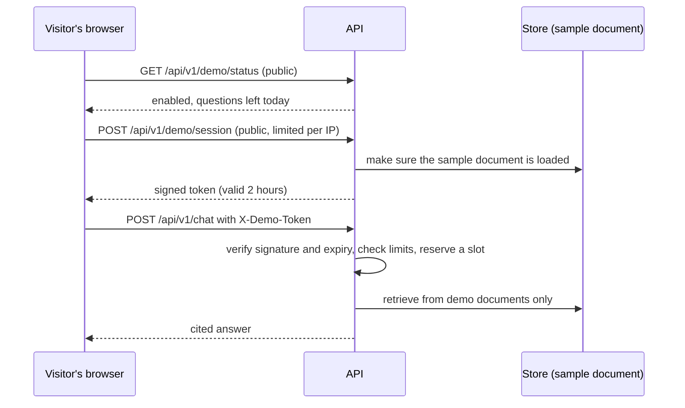

# Demo mode (Phase 6)

Demo mode lets anyone try AgentOps from a link, with no sign-up and no token, without giving them access to your documents, your history, or an unlimited model bill. It exists because a recruiter who lands on a token prompt will leave.

## What a visitor can and cannot do

| | Visitor (demo) | Owner (admin token) |
|---|---|---|
| Open the site and click "Try the demo" | yes | n/a |
| Ask questions | yes, about the sample document only | yes, about all documents |
| See the document list | the sample document only | all documents, with a "Demo" tag on shared ones |
| Upload or delete documents | no (403) | yes |
| Read run history | no (403) | yes, with a "Visitor" tag on visitor runs |
| Call `/api/v1/llm/check` | no (403) | yes |
| Daily and hourly question limits | yes | no |

## How it works

### The visitor token
`v1.<expiry>.<visitor id>.<signature>`. The signature is an HMAC of the first three parts, with a key derived from `ADMIN_TOKEN`, so there is no database lookup and no extra secret to manage. It expires after `DEMO_SESSION_MINUTES` (default 120). The page keeps it in `sessionStorage` only, so closing the tab ends the session. A forged, edited or expired token gets a 401, and the page tells the visitor their session expired.
Changing `ADMIN_TOKEN` invalidates every visitor session at once (and of course your own login).

### Two corpora in one store
Every document has a **scope**: `private` (default; what you upload) or `demo` (the bundled sample). The API decides the scope from the caller's role, never from anything the visitor sends:

- Listing, counting, "is there anything to search?" and retrieval all filter by scope.
- A visitor's question is searched only among `demo` chunks. A test uploads a private document containing exactly the words the visitor asks about, and checks that the visitor still gets "not in documents".

One honest caveat: the keyword index computes its statistics over all documents; only the returned passages are filtered. Private text never reaches a visitor or a prompt, but the relative ranking of demo passages can be nudged by private vocabulary.

### The sample document
`backend/app/demo/documents/agentops-overview.md` describes AgentOps itself, so a visitor can ask how it works and get answers grounded in a real document. It is loaded automatically at startup (in the background) and again when a visitor session starts, so a database that was asleep during startup is covered. Seeding is idempotent: it adds the document only if a demo document of that name is missing. If you delete it, it returns after the next restart.
The four example questions on the page are checked by a backend test against the real retrieval code, so they always find evidence.

## Limits

Defaults are conservative because the model is on a free quota. Change them with environment variables.

| Variable | Default | What it protects against |
|---|---|---|
| `DEMO_ENABLED` | `false` | Demo mode is opt-in |
| `DEMO_SESSION_MINUTES` | 120 | How long a visitor token lives |
| `DEMO_SESSIONS_PER_IP_HOUR` | 10 | One network minting many sessions |
| `DEMO_QUESTIONS_PER_VISITOR_HOUR` | 12 | One visitor hammering the model |
| `DEMO_QUESTIONS_PER_IP_HOUR` | 20 | One network using many sessions |
| `DEMO_QUESTIONS_PER_DAY` | 60 | Total daily spend across everyone. **Set this from your model's free quota** (see below) |
| `DEMO_MAX_CONCURRENT` | 2 | Too many answers running at once on a small server |
| `DEMO_MAX_QUESTION_CHARS` | 300 | Very long prompts |
| `TRUSTED_PROXIES` | 1 | How many proxies sit in front of the app (see "Checking client IPs") |

When a limit is hit the API answers `429` with a plain sentence and a `Retry-After` header, and the page shows the sentence ("You have reached the demo's hourly question limit. Try again in 12 minutes."). When the daily cap is reached the "Try the demo" button is disabled and says so. The owner is never subject to these limits.

### Choosing the daily cap
One question costs one to four model calls (an answer, plus a rewrite and another answer on a retry). Free models on OpenRouter have had small daily request allowances that depend on your account, and they change, so look up your current allowance and set `DEMO_QUESTIONS_PER_DAY` so that questions times the typical calls stays below it, leaving room for your own testing. If you configure backup providers (see [PROVIDERS.md](PROVIDERS.md)), a rate-limited primary fails over to another provider's quota, which can stretch the cap. The cap is shared with nobody but the visitors; your own questions use the same provider quota but are not counted.

## Abuse scenarios

| What someone might try | What stops it |
|---|---|
| Read your private documents by asking about them | Retrieval for visitors only sees `demo` documents (tested) |
| Upload, delete, or read history | 403 for visitor tokens on those routes |
| Forge or edit a token, or reuse an old one | Signature check and expiry; 401 |
| Mint endless sessions to dodge limits | Sessions per IP per hour; the daily cap applies to everyone regardless |
| Spoof `X-Forwarded-For` to look like many IPs | Only the entry added by your own proxy is trusted (`TRUSTED_PROXIES`); tested |
| Run up the model bill | Daily cap, hourly caps, 300-character questions, 2 concurrent answers |
| Overload the 512 MB server | Concurrency cap and the same limits |
| Prompt injection to leak instructions | A visitor can only reach the sample document; the system prompt holds nothing secret |

## Privacy: what is stored

- Visitor questions and answers are saved in the `runs` table with `actor = visitor`, so you can review how the system behaves. The connect screen says so.
- LangSmith traces contain the same text. Set `LANGSMITH_HIDE_INPUTS=true` and `LANGSMITH_HIDE_OUTPUTS=true` if you prefer not to keep it there.
- Server logs never contain question text. Demo sessions log a short hash of the caller's IP address, not the address.
- To delete visitor history (Neon SQL editor): `DELETE FROM runs WHERE actor = 'visitor';`

## Turn it on

1. Push the code (the database migration `0002` runs automatically at startup; existing documents stay private and existing runs stay yours).
2. In the API service's Environment add `DEMO_ENABLED` = `true` (and any limit you want to change). The API redeploys.
3. Check `https://<your-api>/api/v1/demo/status`: it should say `"enabled": true` with the questions left today.
4. Open your frontend site in a private window: "Try the demo" appears. Click it, try an example question.
5. Sign in as owner (Owner sign in) and open History: the demo run is there with a "Visitor" tag.

Locally: add `DEMO_ENABLED=true` to `.env`; the backend loads the sample document at startup.

## Keep the server awake (optional)

The free API sleeps after 15 idle minutes and takes about a minute to wake, which is a poor first impression for a recruiter. A free uptime monitor that requests `https://<your-api>/health` every 5 minutes keeps it awake. Check the current free terms of the service you pick (UptimeRobot, StatusCake, HetrixTools and cron-job.org all have free plans; plans and limits change, and sources disagree on the details, so read the plan page), and note:

- A service that never sleeps uses about 744 instance hours in a 31-day month, and Render's free allowance is 750 hours per workspace shared by all free web services. That fits **one** always-on free service. Static sites do not use instance hours. Verify the current allowance on Render's pricing page.
- `/health` deliberately does not touch the database, so Neon still sleeps when idle. The first question after a quiet period can take a few seconds longer while it wakes.
- Turn the monitor off when you are not job hunting if you want to save the hours.

## Checking client IPs

Per-IP limits need the real caller address. Render puts its load balancer in front of the app, which appends the caller's address to `X-Forwarded-For`; the app trusts the last `TRUSTED_PROXIES` entry (default 1). To verify on your deployment:

1. Start a demo session from your phone (mobile data) and from your computer.
2. In the API's logs find the two `demo_session` lines and compare `ip_hash`.
3. Different hashes: correct. The same hash for both: every visitor looks like one address (for example a CDN sits in front, so you are seeing its address). Then per-IP limits are shared by everyone, which is safe but strict; try `TRUSTED_PROXIES=2` and test again.

## Limits of this design (be upfront about them)
- Counters live in memory and reset when the server restarts. Abuse needs sustained traffic, which keeps the server awake, so this is acceptable here; a database-backed counter would be the upgrade.
- Visitors behind the same network address share the per-IP limits.
- Tokens cannot be revoked one by one; rotate `ADMIN_TOKEN` to end all sessions.
- There is no CAPTCHA. Someone with many addresses could mint many sessions; the daily cap still bounds the damage.
- The demo covers one sample document. Letting visitors upload their own would need real accounts and per-user storage.

## Troubleshooting

| Symptom | Cause and fix |
|---|---|
| No "Try the demo" button | `DEMO_ENABLED` is not `true` on the API, or the site's `VITE_API_URL` is empty or wrong (then only Owner sign in shows) |
| Button says the daily limit is reached | `DEMO_QUESTIONS_PER_DAY` used up; resets at 00:00 UTC |
| "The demo documents are not loaded yet" | Seeding has not finished (database waking up). Wait a moment, or start a new session |
| Every visitor hits limits together | Shared client address: see "Checking client IPs" |
| Visitor gets "session expired" quickly | `ADMIN_TOKEN` was changed, or the clock-based expiry passed (default 2 hours) |
| Browser console shows a CORS error on demo calls | The site's address is missing from `CORS_ORIGINS` (see FRONTEND.md) |
