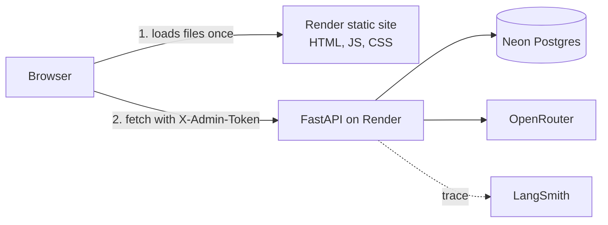
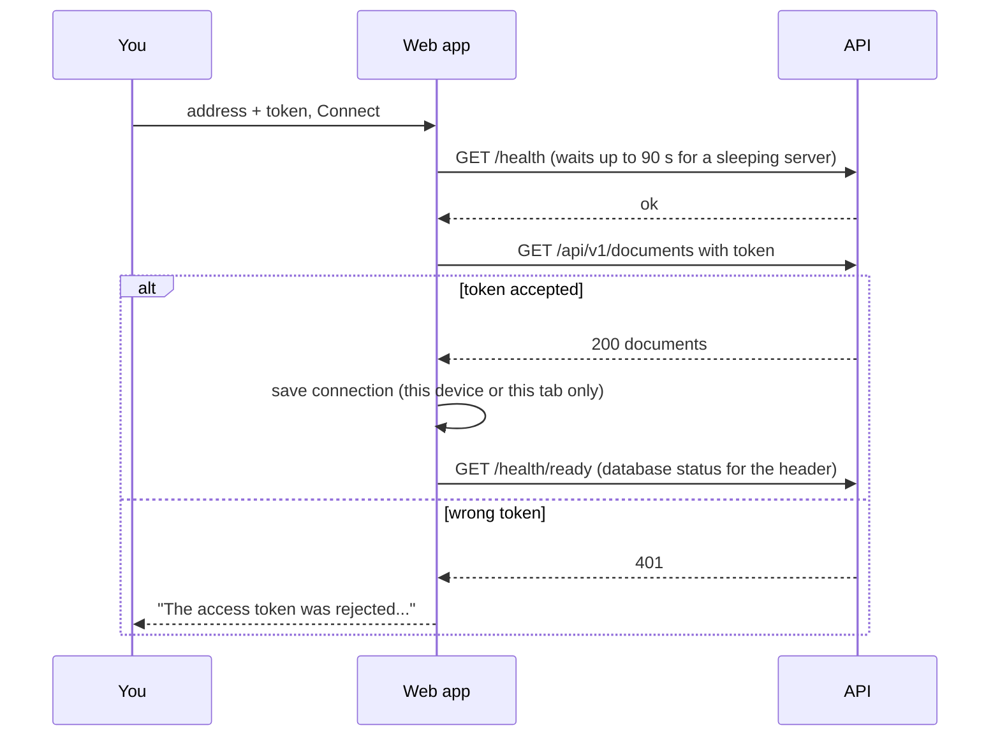
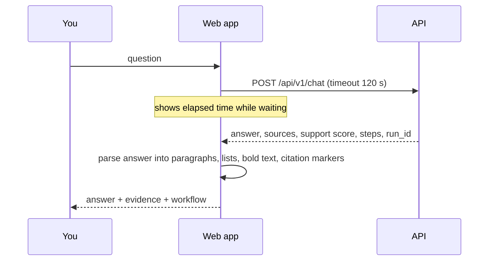

# Frontend (Phase 5)

A single-page app for uploading documents, asking questions, and inspecting what the agent did. React 18 + TypeScript + Vite, plain CSS, no UI, state or router libraries. It ships as static files (about 54 KB of JavaScript, gzipped), so it can be hosted for free.

## What you see

| Screen | What it is for |
|---|---|
| **Connect** | A short description, a **Try the demo** button (one click, no sign-up, see [DEMO_MODE.md](DEMO_MODE.md)), and a collapsed **Owner sign in** form for the server address and access token. The page checks the server (waking it if it is asleep) and verifies the token before letting you in. |
| **Ask** | Left: your documents (upload, drag and drop, delete). Right: a transcript. Each answer shows its citations as small numbered markers; clicking one jumps to the passage in the Evidence column, with the words from your question underlined. Below each answer: support score, number of searches and model calls, time, model, run ID (copyable), and the workflow steps the agent took. A retry shows up as a highlighted `rewrite` step. |
| **History** | Every saved run (needs the database): when, question, result, time. Selecting a row shows the same answer view, so you can inspect old runs and failures. |

Answers that the documents do not support are shown with an amber label ("Not in documents", "Not supported") and plain wording instead of being dressed up as answers. Failures name the cause and say what to do ("The free model hit its rate limit. Wait a minute, then ask again.").

## Demo (visitor) mode in the UI

A visitor who clicks "Try the demo" gets a read-only version of the same screens:

- The header shows "Demo, read-only" and "Exit demo"; there is no History tab and no database status.
- The sidebar shows only the sample document, with no upload, drag and drop, or delete.
- The empty Ask screen offers four clickable example questions; the composer shows the questions left today and a 300-character limit.
- Limits show up as plain sentences from the server (hourly limit, daily limit, busy), and an expired session sends the visitor back to the Connect screen with a notice.
- The visitor session lives in `sessionStorage` only and is ignored once it expires.

The owner sees the full interface; documents shared with the demo carry a "Demo" tag and visitor runs in History carry a "Visitor" tag.

## How it fits together



The static site contains no secrets and no server code. After it loads, the browser talks to the API directly, which is why the API must allow the site's address (CORS, below). Static sites on Render are not on its private network, so this public call is the only option.

### Connecting



### Asking a question



The chat endpoint answers each question on its own, without memory of earlier ones, so the page says so. The transcript lives in the browser only; the persistent record is the History tab.

## Code map

```
frontend/
  index.html, vite.config.ts, tsconfig.json, package.json, package-lock.json
  public/favicon.svg
  src/
    main.tsx            entry point
    App.tsx             connection state, tabs, loads documents and database status
    api.ts              typed API client: token header, timeouts, friendly error messages
    storage.ts          remember the connection (localStorage) or keep it per tab (sessionStorage)
    types.ts            API shapes + AnswerData (one shape for live answers and saved runs)
    lib/answer.ts       safe parsing of model text; highlighting question words in evidence
    lib/format.ts       bytes, durations, relative time, result labels and error hints
    lib/demo.ts         example questions for demo visitors
    components/
      ConnectScreen     demo button + owner sign in, cold-start message
      Header            tabs, server name, database status, disconnect
      DocumentsPanel    upload, drag and drop, inline delete confirmation
      ChatPanel         transcript, composer, progress indicator, retry
      AnswerView        answer text, citations, evidence, metrics, workflow
      HistoryPanel      runs table + detail
    styles.css          all styling
    test/setup.ts       test environment
```

| Piece | Responsibility | Kept out of it |
|---|---|---|
| `api.ts` | Every network call, timeouts, status-to-message mapping, 401 handling | Anything about layout |
| `lib/*` | Pure functions, unit tested | React |
| Components | Rendering and local interaction state | Network details (they receive a client) |

## Design

The brief was an internal tool that looks like a real product, not a template. Decisions that follow from that:

- **Structure from lines, not boxes.** Panes are separated by 1px borders; documents, runs and sources are rows in lists and tables, not a grid of identical cards. Corner radius is 3 to 6px.
- **Palette.** Neutral grays with one steel-blue accent, used only for things you can act on or follow (links between citations and evidence, the active tab, the primary button). Green, amber and red appear only as result labels and messages.
- **Type.** System UI fonts for the interface (Segoe UI on Windows, San Francisco on Mac), so nothing is downloaded and it looks native. Answers are set in a serif reading face (Charter, Sitka, Cambria or Georgia depending on the system) at a 66-character line length, so the answer reads as text and the interface stays quiet around it. Numbers use tabular figures. Monospace is used only for the run ID.
- **Motion only where it answers an action.** The thin indeterminate line while a question is pending, the chevron turning when a source opens, the fade when a citation highlights its source, and placeholder pulsing while lists load. There are no entrance animations, hover lifts, gradients, glass effects, glows or emoji. `prefers-reduced-motion` turns all of it off.
- **Copy.** Plain verbs and sentence case: "Upload", "Ask", "Delete", "Disconnect". Empty states say what to do. Errors say what happened and how to fix it.
- **Dark mode** follows the operating system.

| Token | Light | Dark | Used for |
|---|---|---|---|
| canvas | `#ffffff` | `#15181d` | page and panels |
| subtle | `#f5f6f8` | `#1b1f26` | sidebar, row hover, workflow chips |
| border | `#d9dce1` | `#2d333b` | dividers |
| text / text-2 / text-3 | `#1f2328` / `#4f5760` / `#626a73` | `#e6e8eb` / `#a9b0b9` / `#8a929c` | primary, secondary, tertiary text |
| accent | `#1d5fa6` | `#6aa5e8` | actions, citations, active tab |
| ok / warn / danger | `#1a7f4b` / `#8a5300` / `#b3261e` | `#57c28a` / `#e0b45a` / `#f0867d` | result labels and messages |

Accessibility: real buttons and labels throughout, visible keyboard focus, answers announced through a polite live region, text contrast of at least 4.5:1 in both themes, and a layout that stacks on narrow screens.

## Security model (read this before sharing the link)

- **The owner token is never in the bundle.** If it were, anyone opening the public site could read it. You type it on the Connect screen instead. Demo visitors receive a different, short-lived, read-only token from the server when they click "Try the demo".
- **Where it is stored.** With "Remember on this device" checked it is kept in the browser's `localStorage`; unchecked, in `sessionStorage` (gone when the tab closes). Any script running on the site's origin could read it, which is acceptable for a single-user tool you control and is why the site has no third-party scripts. Leave "Remember" off on shared computers.
- **One shared token, full access.** Whoever has it can upload, delete and read history. Real accounts and per-user data are the next security step (see Limitations).
- **Model and document text is never inserted as HTML.** It is parsed into plain pieces and rendered by React as text (covered by a unit test), so a malicious document cannot inject markup into the page.
- **CORS.** The API only answers browsers from the origins listed in `CORS_ORIGINS`, and rejects `*` at startup.
- **Headers.** The static site sends `X-Content-Type-Options`, `X-Frame-Options: DENY` and `Referrer-Policy: no-referrer`. A stricter Content-Security-Policy is included, commented out, in `render.yaml`; enable it once you have confirmed the site works.

## Run it locally (Windows PowerShell)

You need Node.js 18 or newer (`node -v`). If missing: `winget install OpenJS.NodeJS.LTS`, then reopen PowerShell.

1. Backend: make sure `.env` has `CORS_ORIGINS=http://localhost:5173,http://127.0.0.1:5173`, then from `backend/`: `uvicorn app.main:app --reload`.
2. Frontend, in a second window:
   ```powershell
   cd frontend
   npm install
   Copy-Item .env.example .env.local      # optional: default server address
   npm run dev
   ```
3. Open http://localhost:5173, enter `http://127.0.0.1:8000` and your `ADMIN_TOKEN`.

| Command (from `frontend/`) | What it does |
|---|---|
| `npm run dev` | Dev server with hot reload |
| `npm test` | 44 unit and component tests |
| `npm run typecheck` | TypeScript check |
| `npm run build` | Type-check, then build into `dist/` |
| `npm run preview` | Serve the built `dist/` locally |

## Deploy to Render (free static site)

Render static sites are free, served from a CDN, and never sleep. Only build-time variables exist for static sites, so `VITE_API_URL` is baked into the build and is just the default address on the Connect screen.

The order matters because each side needs the other's address:

1. **Create the static site.**
   - *Using the Blueprint:* push the repo, then in Render open **Blueprints**, your blueprint, **Sync** (or **New, Blueprint**). It proposes a second service, `agentops-web`. Enter `VITE_API_URL` = your API address, such as `https://agentops-api.onrender.com`.
   - *Manually:* **New, Static Site**, pick the repo, then: Root Directory `frontend`, Build Command `npm ci && npm run build`, Publish Directory `dist`. Add environment variables `NODE_VERSION` = `20.18.0` and `VITE_API_URL`. Under **Redirects/Rewrites** add a rewrite from `/*` to `/index.html`.
2. **Note the site's address** once it is live (for example `https://agentops-web.onrender.com`).
3. **Allow it on the API.** In the API service's Environment, set `CORS_ORIGINS` to that address (no trailing slash; several origins can be comma-separated). Render redeploys the API.
4. **Open the site**, enter the API address and `ADMIN_TOKEN`, and connect.

Every `git push` redeploys whatever changed. Free tier terms change, so check Render's current pricing page; static site traffic counts against your workspace's monthly free bandwidth.

### Live checklist
- [ ] Site loads; the browser console shows no CORS errors
- [ ] Connect succeeds (first connect after the API slept can take about a minute)
- [ ] Header shows "Database connected"
- [ ] Upload `samples/acme_policy.txt`; it appears in the list
- [ ] Ask "What is the refund policy for enterprise customers?": answer with a citation, evidence shown
- [ ] Ask something unrelated: amber "Not in documents" result
- [ ] History lists both runs; the run ID matches the one in LangSmith
- [ ] Reload the page: still connected (if "Remember" was on)
- [ ] Disconnect returns to the Connect screen and the token is gone

## Troubleshooting

| Symptom | Cause and fix |
|---|---|
| Connect says "Could not reach the server" | Wrong address, or the API is waking up (wait a minute and retry). For a local API use `http://127.0.0.1:8000` |
| Browser console: "blocked by CORS policy" | The site's exact address is missing from `CORS_ORIGINS` on the API (scheme and host must match, no trailing slash). Fix it and wait for the API to redeploy |
| "The access token was rejected" | Use the API's `ADMIN_TOKEN` (production and local tokens differ) |
| Blank page after deploy | Check the build log; confirm Root Directory `frontend` and Publish Directory `dist`. If you enabled the CSP header, remove it to test |
| Mixed content error | An `https` site cannot call an `http` API. Use the API's `https` address |
| Header says "No database, memory only" | `DATABASE_URL` is not set on the API; documents will not survive restarts |
| History says it needs a database | Same cause as above |
| Build fails on `npm ci` | `package-lock.json` is out of sync with `package.json`: run `npm install` locally and commit the lockfile |
| Question stays pending for a long time | Free models can take 10 to 30 seconds; after 120 seconds the page stops waiting and offers "Ask again" |

## Limitations and next steps
- One shared access token and one shared document set: real authentication and per-user documents are the next security milestone.
- No streaming: the answer appears all at once, because the API returns a finished answer.
- No conversation memory: each question is independent, and the page says so.
- History shows the latest 50 runs and has no search yet.
- The layout was built to the design notes above and checked by unit and component tests and a real-server API check, but treat the first look in your own browser as the final review and tell me what to adjust.
